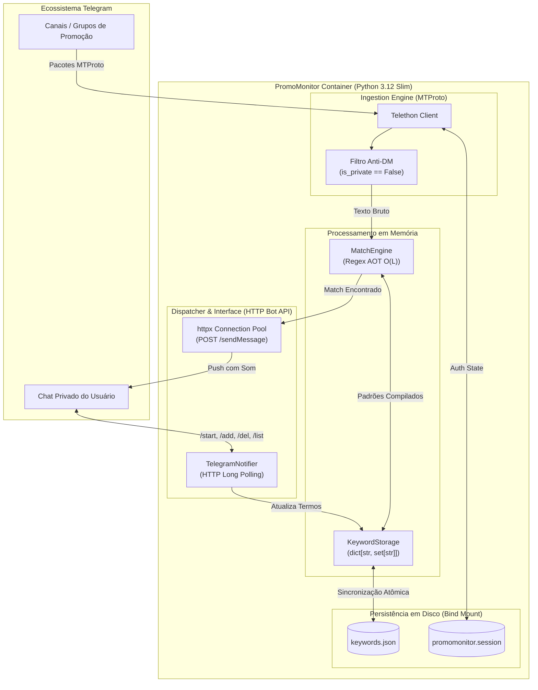
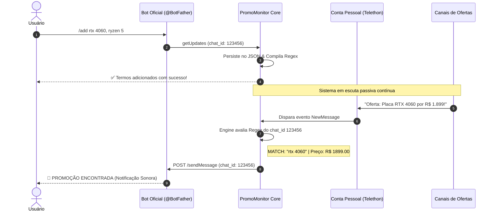

# PromoMonitor

Sistema assíncrono para raspagem passiva e monitoramento contínuo de canais e grupos de promoções no Telegram, com entrega individual de alertas sonoros (*push notifications*) e filtragem granular de palavras-chave via Bot API.

---

## 🎯 Por que o PromoMonitor?

Canais de ofertas e grupos de descontos no Telegram publicam dezenas de mensagens por minuto. Acompanhar esse fluxo manualmente gera fadiga de notificações ou perda de ofertas de curta duração.

Soluções convencionais baseadas apenas na **Telegram Bot API** falham nesse cenário: bots oficiais não conseguem ler mensagens de canais ou grupos de terceiros a menos que sejam adicionados como administradores pelos donos desses canais.

O **PromoMonitor** resolve esse dilema através de uma abordagem híbrida:

* **Ingestão Passiva via MTProto (Telethon):** Conecta-se como cliente de usuário normal, tendo acesso de leitura a qualquer canal ou grupo público/privado onde a sua conta esteja presente.
* **Despacho e Autoatendimento via Bot API (httpx):** Envia notificações em chats privados com alertas sonoros ativados e oferece uma interface conversacional para que múltiplos usuários gerenciem seus próprios termos de busca de forma independente.

## 🏗️ Arquitetura do Sistema

O sistema é executado em um único contêiner Docker rootless, dividindo a aplicação em dois ciclos assíncronos concorrentes sob o mesmo loop de eventos (`asyncio.gather`):



### Detalhamento dos Componentes

1. **Ingestion Layer (`promomonitor.bot.client`):** Mantém o socket TCP com o MTProto do Telegram. Descarta mensagens privadas imediatamente no topo do loop de eventos para proteger a privacidade e economizar CPU.

2. **Match Engine (`promomonitor.bot.engine`):** Compila todas as palavras-chave do usuário em uma única árvore Regex global com demarcadores de borda (`\b`). A busca opera em complexidade $O(L)$ (onde $L$ é o tamanho do texto da mensagem), independente do volume de termos cadastrados. Extrai preços em formato monetário BRL via Regex auxiliar.

3. **Dispatcher & UI (`promomonitor.bot.notifier`):** Roda um loop de *Long Polling* (`getUpdates`) com a Bot API oficial. Identifica o remetente automaticamente pelo `chat.id`, garantindo que cada usuário interaja apenas com a sua própria lista de monitoramento.

4. **Storage Layer (`promomonitor.storage`):** Gerencia a persistência no arquivo `keywords.json`. Utiliza conjuntos nativos (`set`) em memória para operações matemáticas de união, diferença e interseção de termos em $O(1)$.

---

## 🔄 Fluxo de Notificação



---

## ⚙️ Variáveis de Ambiente (`.env`)

Copie o arquivo de exemplo e preencha as credenciais:

```bash
cp .env.example .env

```

| Variável | Tipo | Descrição | Exemplo | Obrigatório |
| --- | --- | --- | --- | :-: |
| `API_ID` | `int` | ID da aplicação no [Telegram MTProto](https://my.telegram.org) | `1234567` | Sim |
| `API_HASH` | `str` | Hash da aplicação no [Telegram MTProto](https://my.telegram.org) | `0123456789abcdef` | Sim |
| `BOT_TOKEN` | `str` | Token HTTP gerado pelo [@BotFather](https://t.me/BotFather) | `123456:ABC-DEF...` | Sim |
| `SESSION_NAME` | `str` | Nome base do arquivo SQLite de sessão | `promomonitor` | Não |
| `STORAGE_PATH` | `str` | Caminho do arquivo JSON de palavras-chave | `keywords.json` | Não |

---

## 🚀 Instalação e Execução

### 1. Pré-inicialização: Autenticação da Sessão MTProto (`.session`)

Antes de rodar o contêiner em segundo plano (detached mode), é obrigatório gerar o arquivo de sessão SQLite (`promomonitor.session`).

Ao conectar via protocolo MTProto pela primeira vez:

1. O Telegram não aceita logins desatendidos sem sessão prévia.
2. O Telethon solicitará no terminal o seu número de telefone (com DDI e DDD, ex: `+5591987654321`).
3. O Telegram enviará imediatamente uma mensagem de serviço com um código de verificação numérico dentro do aplicativo oficial do Telegram em outro dispositivo ativo (ou por SMS).
4. Caso sua conta possua verificação em duas etapas ativada (2FA), a senha de nuvem será solicitada.

Por essa razão, o primeiro boot deve ser executado de forma interativa (`-it ou compose run`). Se você subir o contêiner diretamente com `-d` sem o arquivo `.session` existente, o processo falhará silenciosamente ou travará aguardando entrada de texto no stdin.

#### Preparação dos Arquivos e Permissões

O contêiner executa internamente sob o usuário não privilegiado `appuser` (`UID 10001:10001`). Crie os arquivos vazios com permissão de leitura e escrita no host para evitar erros de banco de dados somente leitura (`sqlite3.OperationalError`):

```Bash
touch promomonitor.session keywords.json
chmod 666 promomonitor.session keywords.json
```

#### Executando a Autenticação Interativa

##### Via Docker Compose (Recomendado)

Como já existe um serviço definido no `docker-compose.yml`, basta executar:

```Bash
docker compose run --rm bot
```

##### Via Docker CLI

```Bash
docker run -it --rm \
  --name promomonitor-auth \
  --env-file .env \
  -v "$(pwd)/promomonitor.session:/app/promomonitor.session" \
  -v "$(pwd)/keywords.json:/app/keywords.json" \
  ghcr.io/reali-705/promomonitor:latest
```

Siga as instruções exibidas na tela:

* Digite seu número de telefone completo.
* Insira o código recebido na notificação do Telegram.
* Digite a senha de 2FA (se aplicável).

Assim que o log exibir `Conexão estabelecida. O PromoMonitor está em escuta passiva.`, a autenticação foi concluída e gravada no disco. Pressione `Ctrl+C` para encerrar a sessão interativa.

### 2. Execução Contínua em Produção (Docker Compose)

Com o arquivo promomonitor.session preenchido e gravado, inicie o serviço definitivo em segundo plano:

```Bash
docker compose up -d
```

Para acompanhar o fluxo de escuta e depuração em tempo real:

```Bash
docker compose logs -f bot
```

Para inspecionar o consumo instantâneo de recursos:

```Bash
docker compose stats --no-stream bot
```

Para pausar ou remover os contêineres:

```Bash
# Interrompe o processo mantendo os contêineres
docker compose stop bot

# Desmonta os serviços (seus arquivos de sessão e keywords permanecem preservados no host)
docker compose down
```

### 3. Alternativa: Execução Direta via Docker CLI

Se optar por não utilizar o Compose no host:

```Bash
docker run -d \
    --name promomonitor \
    --restart unless-stopped \
    --env-file .env \
    -v "$(pwd)/promomonitor.session:/app/promomonitor.session" \
    -v "$(pwd)/keywords.json:/app/keywords.json" \
    ghcr.io/reali-705/promomonitor:latest
```

* Acompanhar logs: `docker logs -f promomonitor`
* Checar telemetria: `docker stats --no-stream promomonitor`
* Parar e remover contêiner: `docker stop promomonitor && docker rm promomonitor`

---

## 🤖 Guia de Comandos do Bot

Qualquer usuário pode interagir com o bot via chat privado. Não é necessário fornecer IDs numéricos; o bot isola o contexto automaticamente:

| Comando | Descrição | Exemplo de Uso |
| --- | --- | --- |
| `/start` | Inicia o atendimento e autoriza notificações do bot | `/start` |
| `/add <termos>` | Cadastra palavras-chave separadas por vírgula | `/add rtx 4060, ryzen 7, oled` |
| `/del <termo>` | Remove um termo específico da sua lista | `/del rtx 4060` |
| `/list` | Lista todas as palavras-chave ativas do usuário | `/list` |
| `/help` | Exibe o menu de instruções e sintaxe | `/help` |

---

## ⚡ Eficiência de Recursos e Otimização

O projeto foi projetado para operar com custo computacional mínimo em servidores domésticos e homelabs:

* **Multi-Stage Build:** A imagem final descarta ferramentas de build, compiladores e caches do `uv`, reduzindo a superfície de ataque e o tamanho da imagem.
* **Eliminação de Wrappers:** A aplicação executa como processo raiz (`PID 1`) chamando o binário do ambiente virtual diretamente, sem intermediários de shell.
* **Footprint Observado:**
* **RAM Residente:** ~53.5 MiB (dentro de uma cota segura de 128 MiB).
* **Processos Ativos:** 2 PIDs.
* **CPU em repouso:** 0.00%.

---

## 📚 Documentação Complementar

Para especificações arquiteturais aprofundadas, decisões de design e guias de infraestrutura:

* [Arquitetura e Ciclo de Vida](docs/architecture.md) — Detalhamento da concorrência assíncrona, alocador de memória e complexidade algorítmica.
* [Backlog de Débitos Técnicos](https://github.com/reali-705/promomonitor/issues) — Acompanhamento das próximas melhorias

---

## 📄 Licença

Distribuído sob a licença MIT. Consulte o arquivo [LICENSE](https://github.com/reali-705/promomonitor/LICENSE) para obter mais informações.
