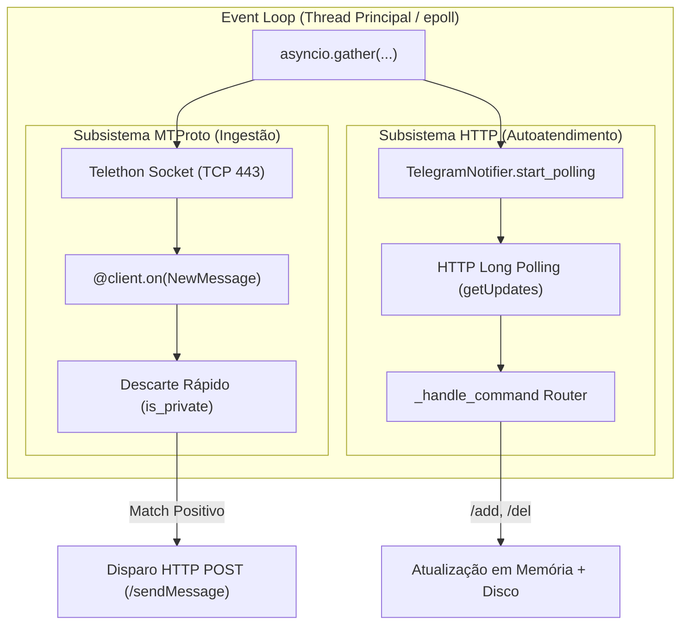
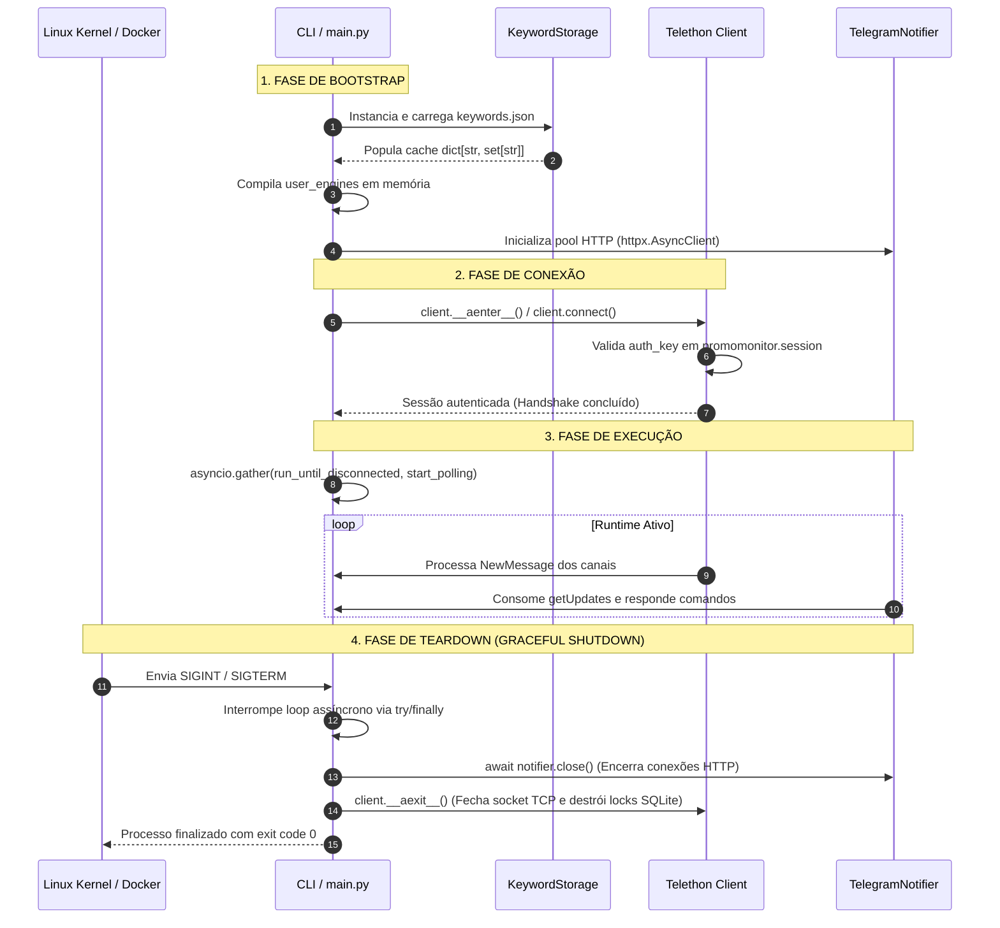

# Arquitetura e Ciclo de Vida

O **PromoMonitor** implementa o padrão arquitetural **Ingestion & Dispatcher Desacoplado**, consolidado em um único processo assíncrono não privilegiado (*rootless*) sobre o runtime CPython 3.12. Este documento formaliza o modelo de concorrência, a análise de complexidade algorítmica, o comportamento de memória no Linux e o ciclo de vida operacional do sistema.

---

## 1. Modelo de Concorrência e Pipeline Assíncrono

A aplicação opera sobre uma única thread gerenciada pelo **Event Loop do `asyncio`**, utilizando a syscall `epoll` do kernel Linux para multiplexação de I/O não bloqueante. Dois subsistemas independentes executam de forma cooperativa sob a primitiva `asyncio.gather`:



* **Ingestão Passiva (MTProto):** Conexão TCP contínua criptografada com os Data Centers do Telegram. O Telethon recebe *updates* binários, desserializa as estruturas TL (*Type Language*) e despacha para os manipuladores registrados.

* **Despacho e Polling (HTTP Bot API):** O `TelegramNotifier` mantém conexões HTTP/1.1 persistentes via `httpx.AsyncClient` com pool de conexões reutilizável. O método `getUpdates` opera em *long polling* com `timeout=30`, bloqueando remotamente no servidor do Telegram sem sobrecarga de CPU local.

* **Comunicação entre Subsistemas:** Ambos compartilham referências em memória da tabela de armazenamento (`storage`) e do dicionário de compiladores (`user_engines`), permitindo que alterações disparadas via HTTP tenham efeito imediato na escuta MTProto sem travamentos (*locks*).

---

## 2. Motor de Casamento AOT e Complexidade Algorítmica

O processamento de texto e a extração de parâmetros monetários utilizam pré-compilação de expressões regulares (*Ahead-Of-Time*).

### Complexidade Temporal

* **Construção do Autômato:** Na inicialização ou mutação (`/add`, `/del`), cada conjunto de termos $K_u = \{k_1, k_2, \dots, k_n\}$ de um usuário $u$ é unificado em um único padrão `\b(k_1|k_2|...|k_n)\b`. A compilação pelo motor `re` converte o padrão em um autômato finito determinístico/não-determinístico (DFA/NFA) em $O(\sum \vert{}k_i\vert{})$.

* **Varredura de Mensagens:** Para cada mensagem de tamanho $L$ recebida de canais, a busca é executada contra os motores compilados:

$$\text{Complexidade Temporal} = O(U \times L)$$

Onde $U$ é o total de usuários ativos cadastrados e $L$ é o comprimento do texto da mensagem. Para a escala de um homelab ($U \le 20$), o tempo de casamento permanece na faixa de microssegundos.

* **Extração de Preço:** Avaliada em $O(L)$ através do padrão `PRICE_REGEX = re.compile(r"(?i)(?:R\$)\s?(\d{1,3}(?:\.?\d{3})*(?:,\d{2})?)")`, executada sob demanda (*lazy evaluation*) apenas quando há confirmação de casamento textual.

---

## 3. Gestão de Memória, Alocador e Persistência

O consumo basal estabilizado em ~53.5 MiB é resultado de restrições arquiteturais aplicadas ao runtime e ao contêiner:

```
+-------------------------------------------------------------+
| Container: promomonitor (Limite cgroups: 128 MiB)           |
|                                                             |
|  +-------------------------------------------------------+  |
|  | CPython 3.12 Runtime (PID 1: appuser 10001:10001)     |  |
|  |                                                       |  |
|  |  +------------------------+  +---------------------+  |  |
|  |  | Telethon Client Heap   |  | httpx Connection    |  |  |
|  |  | (~35 MiB RSS)          |  | Pool (~8 MiB RSS)   |  |  |
|  |  +------------------------+  +---------------------+  |  |
|  |  +------------------------+  +---------------------+  |  |
|  |  | user_engines (Regex)   |  | KeywordStorage      |  |  |
|  |  | (~2 MiB RSS)           |  | Dict/Sets (<1 MiB)  |  |  |
|  |  +------------------------+  +---------------------+  |  |
|  +-------------------------------------------------------+  |
|                                                             |
|  glibc MALLOC_TRIM_THRESHOLD_=65536                         |
|  Evita retenção de páginas desalocadas de volta ao kernel   |
+-------------------------------------------------------------+
         │                                         │
         ▼ (Bind Mount)                            ▼ (Bind Mount)
  /app/promomonitor.session                  /app/keywords.json
  (SQLite3 com Journal)                     (JSON formatado UTF-8)

```

* **Fragmentação de Heap e glibc:** A variável de ambiente `MALLOC_TRIM_THRESHOLD_=65536` no `Dockerfile` reduz o limiar padrão da biblioteca C (128 KB) para 64 KB. Isso força o interpretador a devolver blocos de memória desalocados pelo Garbage Collector diretamente ao kernel via `sbrk`/`madvise`, mitigando o acúmulo contínuo de memória residente (*RSS*).

* **Persistência de Sessão (SQLite):** O arquivo `.session` armazena a chave criptográfica de autenticação (`auth_key`), hashes de acesso e metadados de entidades. O contêiner roda como `UID 10001` (`appuser`); a pasta `/app` mantém permissão de escrita para viabilizar a criação de arquivos de trava e controle transacional do SQLite (`-journal` / `-wal`).

* **Persistência de Palavras-Chave (JSON):** A classe `KeywordStorage` mantém a estrutura `dict[str, set[str]]` em RAM. Escritas executam serialização atômica convertendo conjuntos em listas ordenadas para garantir determinismo no armazenamento em disco.

---

## 4. Ciclo de Vida da Aplicação e Teardown Gracioso

O fluxo de vida do processo é projetado para evitar transações SQLite corrompidas e sockets órfãos no encerramento:



1. **Bootstrap:** Leitura das configurações validadas pelo Pydantic (`Settings`), carregamento do JSON de palavras-chave e pré-compilação dos motores Regex.

2. **Handshake MTProto:** Abertura do socket TCP e autenticação com os servidores do Telegram usando o arquivo de sessão local.

3. **Loop Concorrente:** Execução contínua da escuta de eventos MTProto em paralelo com o polling HTTP.

4. **Teardown Gracioso:** Interrupções via `SIGINT` (Ctrl+C) ou `SIGTERM` (parada do contêiner) disparam a cláusula `finally` em `main.py`, invocando o fechamento limpo das sessões `httpx` e liberando os descritores de arquivo do SQLite.
